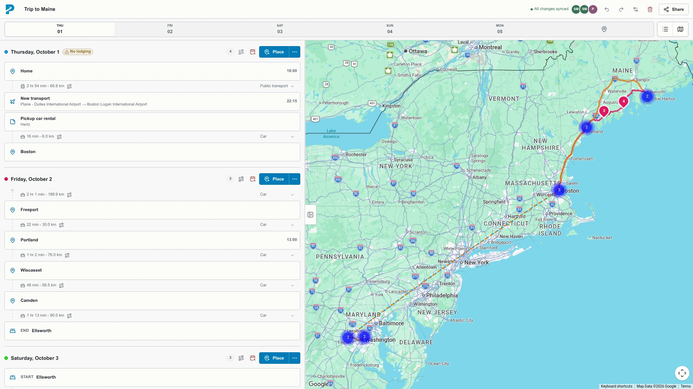

# PaceNotes

PaceNotes is an open source, high-performance web itinerary planner. Several people can edit one fixed-date trip in real time without an account. The Expenses tab tracks shared costs, balances, and payments in the trip currency. Anyone with the trip URL can edit these records.



## Start locally

1. Install Nix with flakes and direnv.
2. Run `direnv allow`.
3. Copy `.env.example` to `.env`.
4. Add a restricted Google browser key and a Google map ID.
5. Run `docker compose -f compose.dev.yaml up --build`.
6. Open `http://localhost:3000`.

For application development:

```sh
docker compose -f compose.dev.yaml up db
pnpm --dir app install
pnpm --dir app db:migrate
pnpm --dir app dev
```

## Checks

```sh
pnpm --dir app typecheck
pnpm --dir app lint
pnpm --dir app test
pnpm --dir app build
pnpm --dir app test:performance
nix flake check
```

Run `pnpm --dir app test:e2e` after the web process and PostgreSQL are ready. Run `pnpm --dir app test:performance` against the production web process on port 3000.

## Deployment

Copy `.env.example` to `.env` and set `GOOGLE_MAPS_API_KEY`, `GOOGLE_MAP_ID`, and a random `RATE_LIMIT_SALT`. The web process also needs PostgreSQL 18 through `DATABASE_URL`. See [deployment](docs/deployment.md) for key restrictions, TLS, backups, and optional settings.

### Docker

Pull the published GHCR image. Supply PostgreSQL 18 separately. Set `DATABASE_URL` in `.env` to an address that the container can reach, not `127.0.0.1` on the host. The image applies migrations before it serves requests.

```sh
docker pull ghcr.io/george-miao/pacenotes:latest
docker run --env-file .env -p 3000:3000 ghcr.io/george-miao/pacenotes:latest
```

### Docker Compose

Use the published application image with the included PostgreSQL service:

```sh
docker compose up -d
```

To build the application image from this checkout instead:

```sh
docker compose -f compose.dev.yaml up --build -d
```

The optional `motis` profile adds the published MOTIS image. Both Compose files start PostgreSQL and apply migrations before the web service starts.

### Nix

Build the application, then start it in the Nix development shell. Export the required environment values first; Nix does not load `.env` for you. PostgreSQL must run separately.

```sh
nix build .#default
nix develop --command sh -c 'cd result/lib/pacenotes && node .output/start.mjs'
```

### Nix Docker

On Linux, build and load the Nix image. Set `DATABASE_URL` in `.env` to a database address that the container can reach.

```sh
nix build .#docker
docker load -i result
docker run --env-file .env -p 3000:3000 pacenotes:nix
```

By default, all methods serve HTTP and `/sync` WebSocket traffic on port 3000. An ordinary push to `main` publishes `main-SHA` and `latest-unstable` container tags. A matching `chore(release): vMAJOR.MINOR.PATCH` commit and tag publish the version and `latest` tags. CI runs on pushes to `main` and on pull requests, not on tag pushes.

Optional runtime values:

- `MOTIS_URL` and `MOTIS_TIMEOUT_MS` for server-side routing
- `FRANKFURTER_URL` for the exchange-rate endpoint (defaults to `https://api.frankfurter.dev`)
- `PACENOTES_EXTERNAL_ENABLED` for JSON-RPC v1 and MCP (defaults to `false`)
- `GOOGLE_MAPS_SERVER_API_KEY` for external place search and inferred trip time zones
- `PACENOTES_EXTERNAL_ALLOWED_ORIGINS` for browser MCP and JSON-RPC WebSocket origins
- `PACENOTES_EXTERNAL_CLIENT_RPM`, `PACENOTES_EXTERNAL_TRIP_RPM`, `PACENOTES_EXTERNAL_SEARCH_CLIENT_RPM`, and `PACENOTES_EXTERNAL_SEARCH_TRIP_RPM` for request limits

## Documentation

- [Architecture](docs/architecture.md)
- [External API, MCP, and source SDKs](docs/external-api.md)
- [Deployment](docs/deployment.md)
- [Routing data and MOTIS](docs/routes.md)
- [Security](docs/security.md)
- [License](LICENSE)
